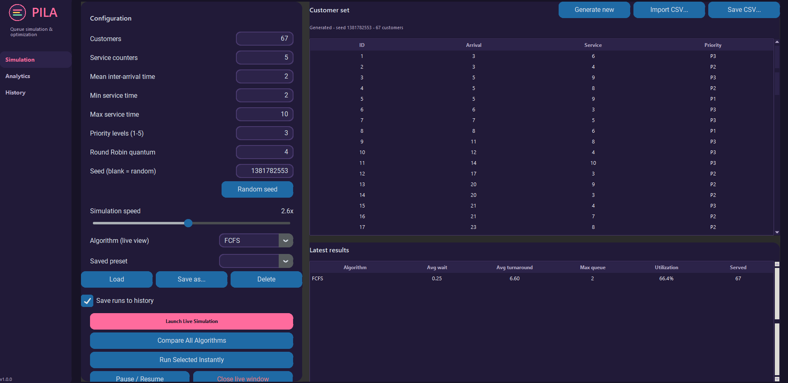

# PILA — Intelligent Queue Simulation & Optimization System

> *Pila* (Filipino/Bisaya for “queue”): watch four scheduling algorithms work through the same line of customers, then compare their results.

PILA is a desktop application for simulating customers arriving at one or more service counters. It supports **FCFS, Priority, SJF, and Round Robin** scheduling. Watch queues move in real time with Pygame, compare algorithms through a Tkinter and Matplotlib dashboard, and save simulation runs in SQLite for later analysis with Pandas.

## Screenshots

| Simulation | Live queue | Analytics | History |
|---|---|---|---|
|  |  |  |  |

## Features

- **Discrete-event simulation engine:** advances from event to event, so results are independent of animation frame rate. Animated and batch runs use the same engine.
- **Four scheduling algorithms:** FCFS, Priority, Shortest Job First (SJF), and Round Robin.
- **Multiple service counters:** configure 1–10 counters and generate random or seeded customers, or import customer data from CSV.
- **Live visualization:** animated arrivals, waiting queues, service counters, customer priorities, progress indicators, and live statistics. Pause, adjust speed, and restart simulations.
- **Analytics dashboard:** compare average waiting, turnaround, and response times, maximum queue length, utilization, throughput, wait by priority, queue-length timelines, and Gantt charts.
- **Simulation history:** save configurations and per-customer results in SQLite, reload runs, filter records, and export data.
- **CSV support:** export comparison summaries, per-customer results, and history.
- **Saved presets and demo scenarios:** includes Bank Branch, Hospital Triage, Fast-Food Rush, and Government Office scenarios.
- **Automated tests:** includes scheduling examples, input validation, database checks, and simulation invariants.

## Installation

**Requirements:** Python 3.9+ (developed and tested with Python 3.12) and Tkinter.

```bash
git clone https://github.com/joshuaarao42-arch/PILA.git
cd PILA

python -m venv .venv

# Windows
.venv\Scripts\activate

# macOS / Linux
source .venv/bin/activate

pip install -r requirements.txt
```

Tkinter is included with the standard Windows and macOS Python installers. On Debian/Ubuntu, install it with:

```bash
sudo apt install python3-tk
```

## Usage

```bash
python main.py                  # Launch the desktop application
python main.py --seed-sample    # Add demo runs to the history and exit
python main.py --db my.db       # Use a custom SQLite database
python -m pila.visualization --algorithm rr --customers 40 --counters 3
python -m pytest                # Run the test suite
```

### Typical workflow

1. Open the **Simulation** tab and configure the number of customers, counters, arrival interval, service-time range, priority levels, Round Robin quantum, and animation speed.
2. Select **Launch Live Simulation** to view the queue animation. Use `SPACE` to pause, `↑/↓` to adjust speed, `R` to restart, and `ESC` to close.
3. Select **Compare All Algorithms** to run all four algorithms using the same generated customers and open the analytics dashboard.
4. Use **Export CSV report** to save the comparison summary and per-customer results.
5. Open **History** to review saved runs, load demo data, or replay a selected run in Analytics.

To import your own customer data, provide a CSV containing `arrival_time` and `service_time`. The `id` and `priority` columns are optional. See [data/sample_customers.csv](data/sample_customers.csv) for an example.

## Scheduling algorithms

| Algorithm | How it works |
|---|---|
| **FCFS** | First Come, First Served — customers are served in arrival order. |
| **Priority** | Serves the highest-priority customer first. Priority 1 is the most urgent. This implementation is non-preemptive. |
| **SJF** | Shortest Job First — selects the customer with the shortest service time. This implementation is non-preemptive. |
| **Round Robin** | Gives each customer a limited time quantum before moving them to the back of the queue if service remains. |

All algorithms use the same generated customer workload during comparisons, making their results directly comparable.

## Metrics

| Metric | Definition |
|---|---|
| Waiting time | Finish time − arrival time − total service time |
| Turnaround time | Finish time − arrival time |
| Response time | First service start − arrival time |
| Utilization | Total busy time ÷ (number of counters × elapsed simulation time) |
| Average / maximum queue length | Time-weighted average / peak number of customers waiting |
| Throughput | Customers served ÷ elapsed simulation time |

Because the algorithms use the same workload and are work-conserving, total service time is identical. Differences in their results mainly come from scheduling order and the final completion time.

## Project structure

```text
PILA/
├── main.py
├── pila/
│   ├── algorithms/       # FCFS, Priority, SJF, Round Robin, and base interface
│   ├── ui/               # Tkinter application, pages, widgets, and charts
│   ├── models.py         # Customer, counter, and simulation configuration
│   ├── engine.py         # Discrete-event simulation engine
│   ├── metrics.py        # Simulation result containers and statistics
│   ├── generator.py      # Customer generation and CSV import/export
│   ├── visualization.py  # Pygame live queue visualization
│   ├── database.py       # SQLite history and presets
│   ├── analytics.py      # Pandas processing and CSV reports
│   └── sample_data.py    # Demo scenarios
├── tests/                # Automated test suite
├── data/                 # Sample customer CSV
├── docs/images/          # README screenshots
├── scripts/              # Screenshot-generation utility
├── requirements.txt
├── requirements-dev.txt
├── pytest.ini
├── CONTRIBUTING.md
└── LICENSE
```

## Testing

Install the development dependencies and run:

```bash
pip install -r requirements-dev.txt
python -m pytest
```

The test suite covers hand-computed scheduling cases, tie-breaking, multiple counters, simulation invariants, configuration and CSV validation, SQLite operations, analytics, CSV export, and headless visualization checks.

## Limitations

- SJF and Priority are non-preemptive; Shortest Remaining Time First (SRTF) and priority aging are not currently implemented.
- Customer arrivals use a Poisson process and service times use a uniform integer distribution.
- History averages can combine scenarios with different workloads. Compare runs from similar configurations for more meaningful conclusions.

## Author

**Joshua C. Arao**  
Computer Science student interested in Python development, algorithms, simulation, and data visualization.

- GitHub: [@joshuaarao42-arch](https://github.com/joshuaarao42-arch)
- Project: [PILA](https://github.com/joshuaarao42-arch/PILA)

## Contributing

Contributions, suggestions, and bug reports are welcome. Please read [CONTRIBUTING.md](CONTRIBUTING.md) before submitting changes.

## License

This project is distributed under the license in [LICENSE](LICENSE).
