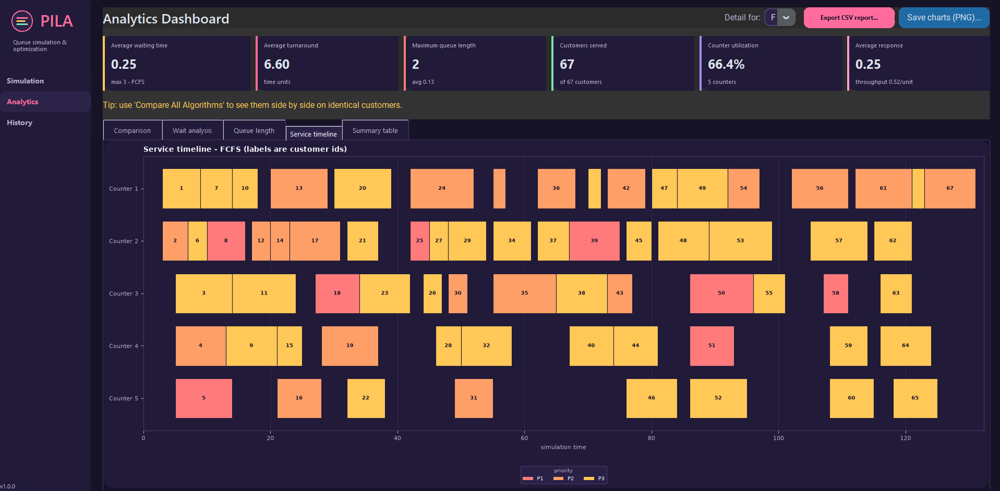
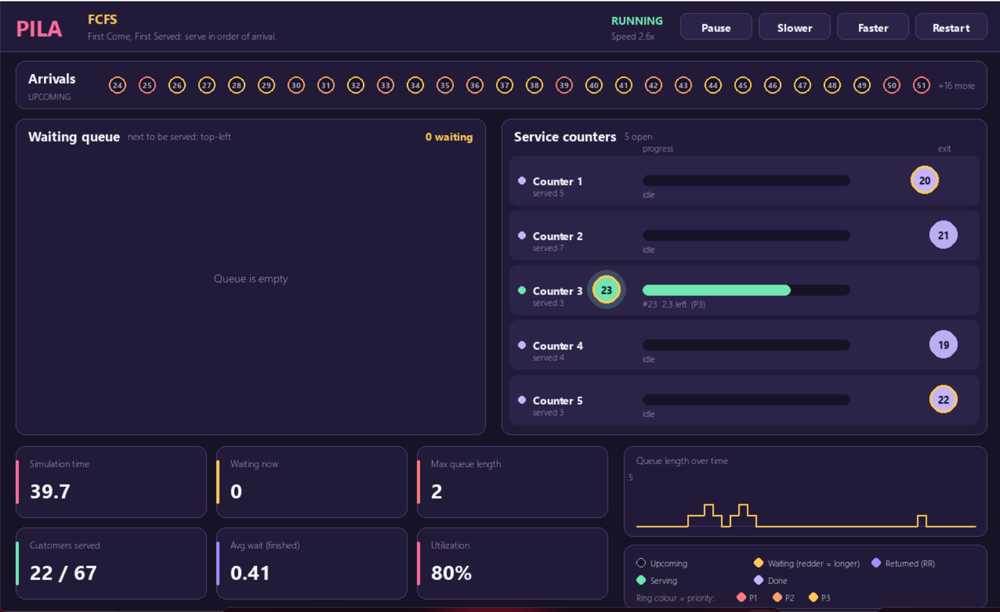
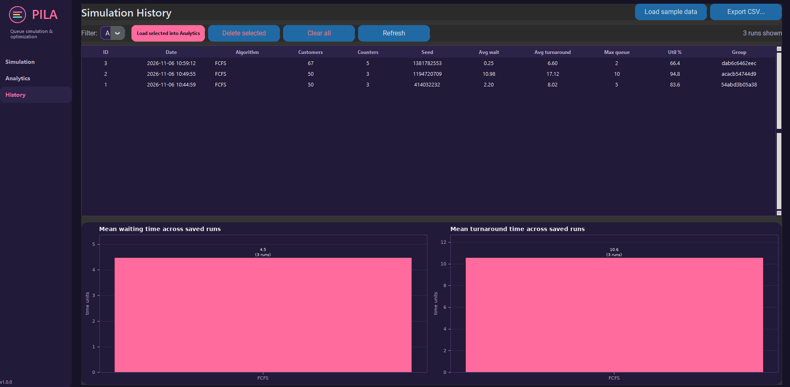

# PILA — Intelligent Queue Simulation & Optimization System

> *Pila* (Filipino/Bisaya for "queue"): watch four scheduling algorithms fight over the same line of customers, then measure exactly who wins and why.

PILA is a desktop application that simulates customers arriving at one or more service counters and serves them with **FCFS, Priority, SJF** or **Round Robin**. You can watch the queue move in real time (Pygame), compare the algorithms on *identical* customers (Tkinter + Matplotlib dashboard), and keep every run in SQLite for later analysis with Pandas.

| Live simulation (Pygame) | Analytics dashboard (Tkinter + Matplotlib) |
|---|---|
|  |  |

## Features

- **Exact discrete-event engine**: time jumps from event to event, so results never depend on frame rate. The animation and the instant batch runs use the *same* engine.
- **Four algorithms**, one module each, behind a small `SchedulingAlgorithm` interface.
- **Multiple counters** (1–10), random or seeded customers, or import your own CSV.
- **Real-time animated view**: customers glide from the arrivals lane to the waiting queue, a counter, and out. Colour = state, ring = priority, progress bars per counter, live stats and a queue-length sparkline. Pause, change speed and restart on the fly.
- **Analytics**: average waiting / turnaround / response time, maximum queue length, customers served, utilization, throughput, wait-by-priority, queue-length timelines and a Gantt chart of every service slice.
- **History**: every run is stored in SQLite (config + per-customer results). Reload any run into the dashboard (it is replayed deterministically), filter, delete, export.
- **CSV export** of comparison summaries, per-customer details and full history.
- **Saved presets** for configurations, plus demo scenarios (Bank Branch, Hospital Triage, Fast-Food Rush, Government Office).
- **155 automated tests**, including hand-computed schedules and invariants checked over random workloads.

## Installation

Requires Python 3.9+ (developed and tested on 3.12) with Tkinter.

```bash
git clone <your-repo-url> PILA
cd PILA
python -m venv .venv
# Windows:  .venv\Scripts\activate        macOS/Linux:  source .venv/bin/activate
pip install -r requirements.txt
```

Tkinter ships with the Windows/macOS installers of Python. On Debian/Ubuntu: `sudo apt install python3-tk`.

## Usage

```bash
python main.py                  # launch the app
python main.py --seed-sample    # fill the history with demo runs (no GUI)
python main.py --db my.db       # use another SQLite file (default: data/pila.db)
python -m pila.visualization --algorithm rr --customers 40 --counters 3   # standalone live window
python -m pytest                # run the tests
```

### Typical workflow

1. **Simulation** tab → set customers, counters, inter-arrival time, service range, priority levels, Round Robin quantum, speed. A seed is chosen automatically and shown, so any run is reproducible.
2. **Launch Live Simulation** opens the Pygame window. Keys: `SPACE` pause · `↑/↓` faster/slower · `R` restart · `ESC` close (the speed slider and buttons in the main window also control it).
3. **Compare All Algorithms** runs the four algorithms on the same customers and opens **Analytics**.
4. **Export CSV report…** writes `report.csv` (summary) and `report_customers.csv` (one row per customer per algorithm).
5. **History** keeps everything; *Load sample data* adds demo runs; *Load selected into Analytics* replays them.

To bring your own data, import a CSV with columns `arrival_time`, `service_time` (required) and `id`, `priority` (optional). See `data/sample_customers.csv`.

## How the numbers are defined

| Metric | Definition |
|---|---|
| Waiting time | `finish − arrival − service` (total time spent queued; includes re-queues in Round Robin) |
| Turnaround | `finish − arrival` |
| Response | `first service start − arrival` |
| Utilization | `total busy time / (counters × (last finish − first arrival))` |
| Avg / max queue length | time-weighted mean / peak number of customers *waiting* (not in service) |
| Throughput | `customers served / (last finish − first arrival)` |

Algorithms: **FCFS** serves by arrival; **Priority** (non-preemptive, 1 = most urgent) can starve low-priority customers, visible in *Max waiting* and the wait-by-priority chart; **SJF** (non-preemptive) minimises average waiting for non-preemptive single-server queues; **Round Robin** gives each customer at most one quantum before re-queueing, trading higher average waiting for fast first response.

Tie-breaking at one instant: finished slices complete → arrivals enqueue → preempted customers re-enqueue → idle counters (lowest id first) pick the next customer.

> Because every algorithm here is work-conserving and uses the same customers, total service time is identical, so **utilization is nearly identical across algorithms**; differences come only from the final finish time. Waiting time, turnaround and queue length are where algorithms differ.

## Architecture

```
PILA/
├── main.py                    # entry point (+ --seed-sample, --db)
├── pila/
│   ├── models.py              # Customer, Counter, SimulationConfig (+ validation)
│   ├── algorithms/            # base.py, fcfs.py, priority.py, sjf.py, round_robin.py, registry
│   ├── engine.py              # discrete-event SimulationEngine, run_simulation, compare_algorithms
│   ├── metrics.py             # result containers + statistics
│   ├── generator.py           # seeded customer generation, CSV import/export
│   ├── visualization.py       # Pygame view (runs in its own process)
│   ├── database.py            # SQLite: history, per-customer records, presets
│   ├── analytics.py           # Pandas processing + CSV export
│   ├── sample_data.py         # demo scenarios
│   └── ui/                    # Tkinter app, pages, widgets, Matplotlib charts, dark theme
├── tests/                     # pytest suite
├── data/                      # sample CSVs (pila.db is created here, git-ignored)
├── scripts/make_screenshots.py
└── docs/images/
```

Design notes:

- **Algorithms are strategies.** They only define a total order over waiting customers (`sort_key`) and an optional quantum (`time_slice`). The engine owns time, counters and the queue, so comparisons are fair by construction. Adding an algorithm = one file + one line in the registry.
- **Pygame runs in a separate process** (`multiprocessing`, spawn) and talks to Tkinter through two queues, avoiding the two GUI loops fighting each other. The finished result flows back and is saved to history.
- **History replays instead of storing timelines.** The database stores configuration and per-customer outcomes; the Gantt/queue timeline is regenerated by replaying the deterministic engine.
- **No circular dependencies**: `models ← algorithms ← engine ← database/analytics ← ui`; charts are pure functions and run headless.

## Testing

```bash
python -m pytest
```

Covers hand-computed FCFS/SJF/Priority/Round Robin schedules, tie-breaking, multi-counter behaviour, and invariants on random workloads for every algorithm (work conservation, no overlapping slices, queue-integral = Σ waiting, SJF optimality vs FCFS/Priority on one counter, stepping == batch), plus config/CSV validation, SQLite round-trips, SQL-injection safety, Pandas aggregation, CSV export and headless chart/Pygame smoke tests.

## Screenshots

| Simulation setup | Service timeline (Gantt) | History |
|---|---|---|
|  |  |  |

Regenerate with `xvfb-run -a -s "-screen 0 1440x960x24" python scripts/make_screenshots.py` (or just run it on a desktop).

## Example (library use)

```python
from pila.models import SimulationConfig
from pila.generator import generate_customers
from pila.engine import compare_algorithms
from pila.analytics import results_to_summary_df

cfg = SimulationConfig(num_customers=60, num_counters=3, seed=101)
results = compare_algorithms(generate_customers(cfg), cfg)
print(results_to_summary_df(results)[["Algorithm", "Avg Waiting", "Avg Turnaround", "Max Queue"]])
```

## Limitations

- SJF and Priority are non-preemptive (no SRTF, no aging).
- Customers are generated with Poisson arrivals and uniform integer service times; other distributions need a change in `generator.py`.
- History averages mix scenarios with different loads; compare within a *Group* for fair conclusions.
